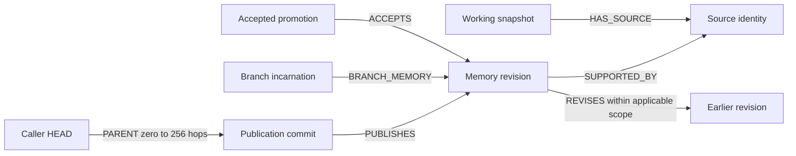

# Git-aware shared memory graph contract

The original evidence contract remains in
[archive/legacy-evidence-graph-contract.md](archive/legacy-evidence-graph-contract.md).
Existing WorkspaceMemory records stay legacy notes; their text never invents Git
bindings. This contract governs connected repositories.

## Identity and records

All nodes are immutable domain records within the bound tenant/storage project.
`workspace_project_id` is the membership boundary and `repo_id` is the connected
repository boundary. `GitRecord.kind` selects these schemas:

| Kind | Meaning |
| --- | --- |
| repository | Credential-free canonical remote + verified root, or explicit existing-repository join |
| commit | Full object ID and exact parents, including unavailable shallow boundary parents |
| branch | Opaque incarnation ID; ref names are observations |
| observation | Connector/user, ref, HEAD, snapshot, previous context and completeness |
| snapshot | HEAD, source manifest, dirty state and manifest coverage |
| source | Relative path + SHA-256 digest of Git canonical blob content address |
| finding | Exact revision, logical key, author/session, origin branch, source HEAD/snapshot, claim classification and paths |
| checkpoint | Separate immutable task revision, author/session and progress |
| transfer | Frozen normal integration result and review status |
| mapping | Frozen rewrite candidates, unique patch signatures and method |
| promotion / accepted_promotion | Exact agent proposal / human owner acceptance |
| capture_receipt | Explicit no-useful-change result |
| agent_token / revoked_token | Durable project-bound issuance and revocation |
| signing_secret | Service-only persisted random signing key when no secure explicit key is configured |

Revision IDs bind project, repository, author, session and delivery event. Identical
replay is idempotent. Changed text/bindings with the same event are an immutable
conflict. Repeated delivery does not create independent evidence. Canonical source
addressing makes LF/CRLF clones agree. Bindings do not establish semantic truth.
Initial branch registration is idempotent on the recorded connector/incarnation,
including response-loss and concurrent retries. The local incarnation includes
reflog birth plus file identity, or a persisted random birth when no reflog exists.
Queued observations keep that original incarnation across deletion/recreation.
Native session and turn IDs come from the transport. Delayed earlier-turn calls
cannot modify the current turn or impersonate another task's checkpoint.

## Relationships

OBSERVED connects branches to connector observations; AT_COMMIT binds an
observation to HEAD. Commit HAS_SOURCE edges support publication checks.
TRANSFERRED_FROM links integration/mapping receipts to exact revisions. The
legacy READ_* exposure semantics remain separate from semantic support.

## Publication and scope

New findings receive only a branch edge. Source history is separate from
publication history. A later observed authored commit publishes pending findings
only when all sources match. Forward integration requires the source tip to be
newly incorporated relative to the previous destination HEAD, plus matching
integrated sources. Candidate sets are frozen at the observed event; later
learning at an old source tip is not retroactively transferred.

Unique stable Git patch-ID mappings or equivalent aggregate squash patches must
connect recorded source history to destination ancestry, with matching sources.
Missing, ambiguous, capped or mismatched mappings remain branch-local and report
needs_review. Shallow history is incomplete. Another clone explicitly joins a
branch ID. Deleted refs or recreated/expired reflogs do not erase old graph nodes.

## Recall and revisions

Candidate paths use origin branch, publication in caller ancestry, or accepted
project conventions. Snapshot/source relationships recheck applicability.
Different unfinished snapshots are wip_requires_verification; changed clean
sources are historical_source_changed. Applicable revisions rank ahead of WIP.
WIP cannot supersede a checkout-verified fact.

The live `git_candidates`, `git_path` and `git_explain` queries resolve their
endpoints and use FalkorDB `shortestPath` over zero to 256 `PARENT` relationships.
They need reachability and one inspectable supporting path, rather than counting
every equivalent ancestry route. A 26-diamond regression has 79 commit nodes and
over 67 million possible routes; the retained pre-fix query timed out while the
bounded shortest-path query returns the actual stored supporting relationships.
Promotion and branch matches remain separate from publication reachability.
Server queries carry a two-second execution timeout; the Redis client has
connection/read timeouts. These bounds do not establish end-to-end recall speed.

REVISES hides an earlier revision only if both apply in the current context.
A correction on one branch cannot globally replace its base. Multiple applicable
revisions with the same logical key remain unresolved conflicts. No timestamp or
voting rule selects truth. Checkpoint edits retain their author/session.

Fixed parameterized FalkorDB operations include git_candidates,
git_applicability, git_revisions, git_path and git_explain. Repository retrieval
never uses the old generic full-graph read caps. Pages have at most 1,024
candidates plus a sentinel; a cap is incomplete. Ancestry is limited to 256 hops.
The bridge defaults to 64 commits and 128 prioritized source paths, configurable
up to 256/2,048. Claims bind at most 20 paths. Files over 1 MB and private paths
are excluded. Coverage is explicit in recall and the UI.

Automatic context includes at most eight findings and two checkpoints within
about 2,000 estimated tokens, with bounded conflict/exclusion records, aggregate
counts and completeness flags. Exact revisions, sources and publication paths
remain available through inspection.

## Trust and durability

HTTP checks project membership and token scope before access. Viewer tokens
cannot capture, synchronize, promote or edit. Acceptance requires a human owner
session. Every request rechecks issuance/revocation, including an established
MCP process. No projectless API silently chooses a default project.

MCP accepts text, paths, relevance queries and exact revision IDs; the local bridge
supplies authoritative Git context. Connector HTTP observations are provenance,
not remote attestation or proof that an interpretation is true. Credential-pattern
and configured-path exclusions reduce accidents; they are not a full DLP product.
The current assistant performs one completion capture pass, with no secondary
model. Native trust is reviewed by the user and never bypassed.

FalkorDB provides server durability. Memory mode is ephemeral. SQLite caches recall
and queues writes. Retries resolve the original offline observation before saving
its memory; they never move a capture to a later branch/snapshot.
