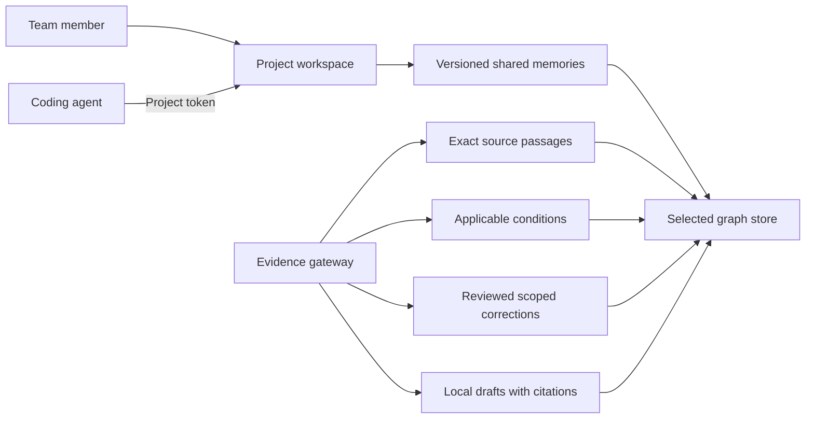
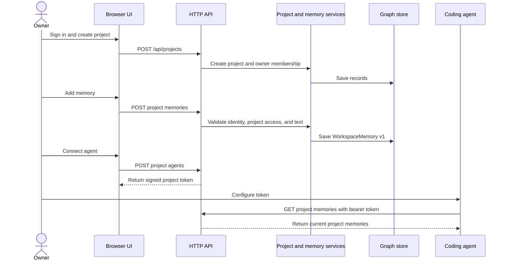
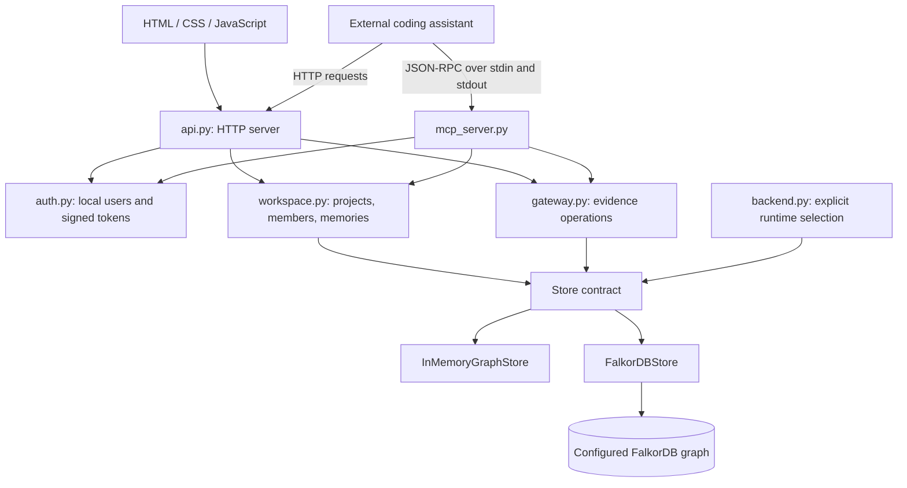
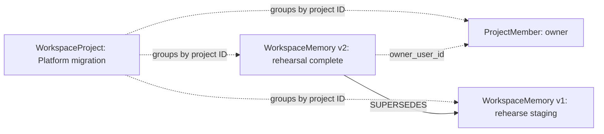
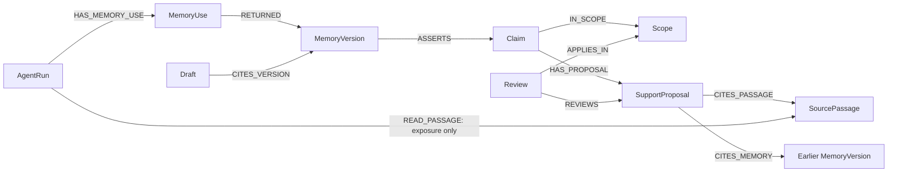
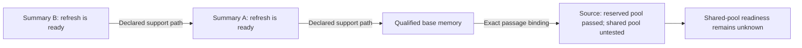
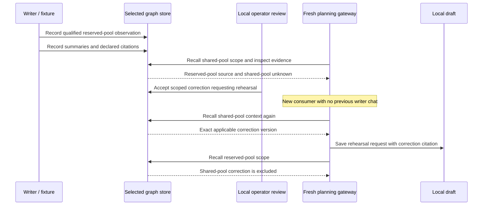
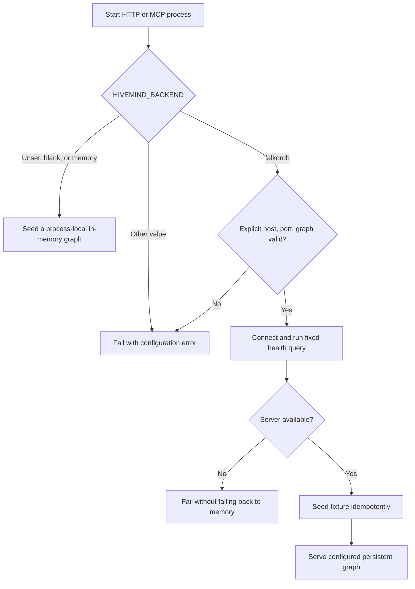

# HiveMind — project summary and illustrated guide

**Shared project memory for people and coding agents.**

Prepared on 17 October 2026 from the implementation at commit `72e9cab`.
This guide explains the current product, its evidence model, how to use it,
and what remains to be validated. All Juniper examples are synthetic.

## 1. What HiveMind does

HiveMind gives a team a place to keep project context that people and coding
agents can read and update. A person signs in, creates a project, records useful
memories, adds configured teammates, and connects an agent using a project token.

Underneath that workspace is an evidence-aware gateway. It records where a
qualified observation came from, which situation it applies to, how later
summaries cite it, and which exact version a local draft uses. This supports a
specific handoff: a fresh agent can recover a scoped correction without needing
the previous conversation.

For example, a team might record:

> Overnight refresh completed on the reserved worker pool. Shared-pool behavior
> has not been exercised.

A later planning agent should retain the worker-pool condition. Repeated
summaries saying “refresh is ready” do not establish shared-pool readiness.



The workspace and evidence gateway share a storage abstraction, but they have
different record types. Saving an ordinary note does **not** automatically create
a claim, discover supporting sources, or make that note an evidence-backed fact.

## 2. Who uses it and why

| User | Typical task | Example benefit |
| --- | --- | --- |
| Project owner | Organize context and access | Keep rollout constraints and agent connections together. |
| Team member | Record or consult project knowledge | Find the current migration note and its earlier versions. |
| Coding agent | Read and write shared context | Recover the staging requirement before proposing a rollout. |
| Capability-planning lead | Examine evidence and scope | Discover that a successful reserved-pool test does not cover a shared pool. |

The original focused scenario is technical customer walkthrough planning. The
current UI offers a broader project-memory workspace around that foundation.
The repository positions HiveMind for the Agent Memory and Coordination and
Company Brain tracks of the Graph Hacks concept described in its project brief.

## 3. A practical team workflow

Imagine a **Platform migration** project shared by an owner and an editor.

1. The owner creates the project and adds a configured teammate through **People**.
2. The owner creates a memory titled **Rollout constraint** with the body
   “Run a staging rehearsal before enabling the shared queue.”
3. The owner selects **Connect agent**, labels the connection **Codex**, and copies
   the project token returned at creation.
4. The agent lists that project's memories through HTTP or its MCP tools.
5. An authorized edit changes the note to include the rehearsal outcome.
6. The UI shows the current memory while storage retains its previous version.



Tokens carry the human user's identity and an agent label. A separate agent label
is useful for identifying a connection; it is not an independent authorization
role or a record of everything that agent thought or did.

## 4. Architecture and code map

The backend uses Python's standard library for its default runtime. The frontend
is plain HTML, CSS, and JavaScript with an SVG memory graph. There is no required
frontend build step and no AI-provider call in the application.



| File or directory | Responsibility |
| --- | --- |
| [`web/`](web/) | Sign-in, projects, SVG graph, memory list/editor, people, agent-token panel. |
| [`hivemind/api.py`](hivemind/api.py) | HTTP routing, identity checks, JSON errors, static files, health and runtime reset. |
| [`hivemind/auth.py`](hivemind/auth.py) | Configured users, process-local browser sessions, HMAC-signed agent tokens. |
| [`hivemind/workspace.py`](hivemind/workspace.py) | Project membership, ordinary memory creation/editing, graph responses. |
| [`hivemind/gateway.py`](hivemind/gateway.py) | Scoped recall, evidence traversal, exposure, corrections, cited drafts. |
| [`hivemind/domain.py`](hivemind/domain.py) | Immutable domain dataclasses and identity/hash helpers. |
| [`hivemind/store.py`](hivemind/store.py) | In-memory and FalkorDB implementations of graph storage. |
| [`hivemind/queries.py`](hivemind/queries.py) | Trusted fixed Cypher query registry. |
| [`hivemind/backend.py`](hivemind/backend.py) | Backend configuration, connection checks, fixture seeding. |
| [`hivemind/mcp_server.py`](hivemind/mcp_server.py) | Fixed MCP tool registry and newline-delimited JSON-RPC handling. |
| [`hivemind/fixture.py`](hivemind/fixture.py), [`demo.py`](hivemind/demo.py) | Synthetic Juniper graph and deterministic cold-handoff walkthroughs. |
| [`tests/`](tests/) | Offline behavior tests and opt-in live integration tests. |
| [`archive/`](archive/) | Historical product exploration and review; not runtime behavior. |

## 5. The two data models

### 5.1 Everyday workspace records

`WorkspaceProject` groups memories and members. `ProjectMember` associates a user
with a project role. `WorkspaceMemory` stores a title, body, tags, owner, timestamps,
and version information.

The store's `tenant_id` and `project_id` identify its underlying data boundary.
The separate `workspace_project_id` identifies the user-facing project within
that boundary. These similarly named fields should not be treated as synonyms.

Editing a workspace memory creates a new immutable record with the same
`memory_key`, an incremented `version`, and a `supersedes_id` pointing backward.
The normal list returns the latest non-archived version per logical memory.
The project graph includes version records, version links, people, and authorship
links; it is not automatically a semantic knowledge graph of the note text.



Dashed links above illustrate record associations. The persisted version
relationship is `SUPERSEDES`; the UI also derives its authorship edges.

### 5.2 Evidence and handoff records

| Record | Meaning | Juniper example |
| --- | --- | --- |
| `CompanyEntity` | The entity discussed | Juniper or its capability. |
| `Scope` | Conditions in which a statement applies | Reserved pool versus shared pool. |
| `SourcePassage` | Immutable source text with artifact/version/hash binding | Exact reserved-pool test passage. |
| `AgentRun` | Recorded agent role/session and observed coverage | Writer run or fresh planning consumer. |
| `MemoryVersion` | A qualified, versioned memory | Refresh observed only on the reserved pool. |
| `Claim` | A proposition attached to a memory | Refresh completed under stated conditions. |
| `SupportProposal` | Declared supporting, qualifying, or contradicting citations | A summary cites the qualified base memory. |
| `Review` | Bounded review of an exact version/proposal and scope | Accept a shared-pool qualification. |
| `MemoryUse` | Receipt for versions returned by recall | Fresh consumer received a correction. |
| `Draft` | Local text with exact citations | Request a shared-pool rehearsal. |



An evidence inspection can recursively follow a cited earlier memory through its
own claim and proposal until it reaches an original passage.

## 6. Why the relationships matter

Suppose summary A and summary B both say “overnight refresh is ready.” If B cites
A and A cites a qualified test observation, the graph can expose their shared
origin. Two restatements are not two independent successful tests.



These arrows compress the claim/proposal relationships from the full schema.
They show why the graph is useful: it makes transitive origin, scope, correction,
and citation relationships inspectable.

Three rules prevent common interpretation mistakes:

- `READ_MEMORY` and `READ_PASSAGE` mean observed exposure. They do not mean a
  source supports a claim or caused a later decision.
- A `SupportProposal` is a declared interpretation. A citation alone does not
  prove that the source entails the claim.
- A traversal cap, cycle, or missing link leaves lineage incomplete. It cannot
  justify a claim that all evidence has been examined or that no evidence exists.

Equivalent relational/provenance implementations can represent these facts too.
The project has not demonstrated that a graph is uniquely capable or more useful
than well-prepared source-linked notes.

## 7. Worked example: the Juniper cold handoff

**Question:** Can the team promise overnight refresh for Juniper's shared-pool
walkthrough?

**Available observation:** Overnight refresh completed on a reserved pool;
shared-pool behavior was not exercised.

| Stage | Action | Meaning |
| --- | --- | --- |
| Recall | Retrieve reserved-pool memory and shared-pool context | Keep the observed success and the missing condition separate. |
| Investigate | Follow summary support paths to the exact source | Discover the qualifier lost in broad summaries. |
| Clarify | Identify which pool the walkthrough needs | The example uses the shared pool. |
| Correct | Store an operator-reviewed shared-pool qualification | Request rehearsal before promising readiness. |
| Cold read | Construct a fresh consumer gateway over the selected store | Recover the correction without the writer's chat. |
| Draft | Save local text citing that exact correction | Make the planning change traceable. |
| Isolate | Recall the reserved scope again | Do not apply the shared-pool correction globally. |



**Before:** “Overnight refresh is ready for the Juniper walkthrough.”

**After:** “Request a shared-pool rehearsal before promising overnight refresh
readiness.”

The demo is deterministic Python. A fresh gateway/session demonstrates the coded
handoff contract; it is not a benchmark of an independently reasoning AI agent.
In memory mode the cold consumer reuses the same store object. Persistence across
store instances is exercised by the separate live tests.

### Run the example directly

From the repository root with Python 3.11 available:

```python
from hivemind import run_demo

result = run_demo()
assert result["ok"]
print(result["draft_before"]["text"])
print(result["draft_after"]["text"])
print(result["cold_selected_memory_id"])
```

The running HTTP server also accepts `POST /api/demo` with `{}` and returns
the detailed walkthrough, including steps, correction, draft, and assertions.
The current projects UI does not contain a cold-handoff button; use the API or
Python example.

## 8. HTTP API with a complete project example

The following PowerShell example creates a project, a memory, and a project agent
token on a local server using the default demo account. It edits the memory and
then reads the project as the agent. Run it once against a disposable local
instance; each run creates another project.

```powershell
$base = 'http://127.0.0.1:8000'

$login = Invoke-RestMethod "$base/api/auth/login" -Method Post `
  -ContentType 'application/json' -SessionVariable hiveSession `
  -Body (@{username='operator'; password='operator'} | ConvertTo-Json)

$created = Invoke-RestMethod "$base/api/projects" -Method Post `
  -WebSession $hiveSession -ContentType 'application/json' `
  -Body (@{name='Platform migration'; description='Rollout context'} | ConvertTo-Json)
$projectId = $created.project.id

$note = Invoke-RestMethod "$base/api/projects/$projectId/memories" -Method Post `
  -WebSession $hiveSession -ContentType 'application/json' `
  -Body (@{title='Rollout constraint'; body='Run a staging rehearsal first.';
           tags=@('rollout','staging')} | ConvertTo-Json)
$memoryId = $note.memory.id

$edited = Invoke-RestMethod "$base/api/projects/$projectId/memories/$memoryId" `
  -Method Patch -WebSession $hiveSession -ContentType 'application/json' `
  -Body (@{body='Staging rehearsal completed; retain the shared-queue check.'} | ConvertTo-Json)
# $edited.memory.version is 2; the v1 record remains in storage.

$connection = Invoke-RestMethod "$base/api/projects/$projectId/agents" -Method Post `
  -WebSession $hiveSession -ContentType 'application/json' `
  -Body (@{label='Codex'} | ConvertTo-Json)

$agentHeaders = @{Authorization="Bearer $($connection.token)"}
$memories = Invoke-RestMethod "$base/api/projects/$projectId/memories" `
  -Headers $agentHeaders
$memories.memories | Select-Object title, body, version
```

Use project routes for project work. The older `/api/workspace` and
`/api/memories` routes operate on the default workspace collection and should
not be assumed to select a token's project automatically.

### Route reference

| Route | Purpose |
| --- | --- |
| `GET /health` | Selected backend and live reachability when configured. |
| `POST /api/auth/login`, `POST /api/auth/logout` | Browser session lifecycle. |
| `GET /api/auth/me` | Current identity. |
| `GET/POST /api/projects` | List accessible projects / create a project. |
| `GET /api/projects/<project_id>` | Project details, members, and memories. |
| `GET /api/projects/<project_id>/graph` | UI nodes and edges. |
| `GET/POST /api/projects/<project_id>/memories` | List current versions / create. |
| `GET/PATCH /api/projects/<project_id>/memories/<memory_id>` | Read / versioned edit. |
| `GET/POST /api/projects/<project_id>/members` | List / add an existing configured user. |
| `GET/POST /api/projects/<project_id>/agents` | List the caller's project connections / mint a token. |
| `POST /api/recall` | Recall evidence-aware memory for an exact `scope_id`. |
| `POST /api/evidence` | Inspect declared support for `memory_id`, with `max_depth`. |
| `POST /api/exposure` | Record a run's exposure to a memory. |
| `POST /api/correction` | Create an immutable, scoped qualification. |
| `POST /api/draft` | Save local text with exact citations. |
| `GET /api/state` | Diagnostic graph state and related context. |
| `POST /api/demo`, `POST /api/reset` | Run the fixture walkthrough / reset selected data. |

JSON failures use an envelope such as:

```json
{"ok":false,"error":{"code":"AUTH_REQUIRED","message":"Sign in or provide a valid agent bearer token"}}
```

Reset replaces memory-mode data or clears and reseeds the selected live graph's
bound tenant/project data. It can remove workspace records in that boundary;
it is not a read-only demo action.

## 9. Connecting an assistant through MCP

MCP exposes eight tools over newline-delimited JSON-RPC on stdin/stdout.
An external assistant supplies the reasoning and decides which tools to call.

| Tool | Inputs and purpose |
| --- | --- |
| `list_memories` | No arguments; list the connected project's workspace notes. |
| `create_memory` | `title`, `body`, optional `tags`. |
| `edit_memory` | `memory_id`, optional replacement `title`, `body`, `tags`. |
| `recall_context` | `scope_id`; scoped evidence-aware recall. |
| `inspect_evidence` | `memory_id`, optional `max_depth`; bounded declared support. |
| `record_exposure` | `run_id`, `memory_id`; exposure receipt only. |
| `apply_correction` | `base_memory_id`, `scope_id`, optional correction text/reviewer. |
| `save_draft` | `scope_id`, `title`, `body`, `citations`. |

Start an MCP process from the repository root:

```powershell
$env:HIVEMIND_AGENT_TOKEN = '<project token copied at creation>'
py -3.11 -m hivemind.mcp_server
```

An assistant's MCP configuration should launch that command with the repository
as its working directory and the required environment values. Send `initialize`
and the initialized notification before normal tool calls. An example request is:

```json
{"jsonrpc":"2.0","id":3,"method":"tools/call","params":{"name":"list_memories","arguments":{}}}
```

Workspace tools require a valid agent identity. The evidence tools are also
available for the local synthetic scenario without that workspace identity.
Tool failures use structured results with `isError: true`; malformed protocol
requests use JSON-RPC errors. Clients cannot submit raw Cypher through a tool.

**Sharing data across HTTP and MCP:** a memory-mode HTTP server and a separately
launched memory-mode MCP server each own a different store. A valid token alone
does not share their notes. To use separate processes against the same persistent
data, configure both for the same FalkorDB graph, signing secret, and user
configuration. An agent can alternatively use HTTP directly against the running
workspace process.

## 10. Runtime profiles and setup



| Setting | Default memory profile | Explicit FalkorDB profile |
| --- | --- | --- |
| Storage | Python objects inside one process | Configured server graph. |
| Restart behavior | User changes are lost | Graph records persist. |
| Dependencies | Python standard library | Optional pinned client and live server. |
| Separate HTTP/MCP processes | Separate data | Can share the configured graph. |
| Health | Process/backend report | Fixed server query as well. |

### Windows quick start

```powershell
py -3.11 -m venv .venv
.\.venv\Scripts\python.exe -m pip install --no-deps -r requirements.txt
$env:HIVEMIND_BACKEND = 'memory'
.\.venv\Scripts\python.exe -m hivemind --host 127.0.0.1 --port 8000
```

Open `http://127.0.0.1:8000/`. The local default account is
`operator` / `operator`.

On Linux or a compatible shell, the existing Make targets provide `make run`,
`make mcp`, `make test`, `make check`, and `make test-live`. The Makefile assumes
`/bin/sh`; the direct Python commands avoid that requirement on Windows.

### Persistent local profile

With Docker available, create the isolated server once:

```powershell
docker run -d --name hivemind-falkordb -p 6380:6379 `
  -v hivemind-falkordb-data:/data falkordb/falkordb:6.0.2
.\.venv\Scripts\python.exe -m pip install -r requirements.lock
$env:HIVEMIND_BACKEND = 'falkordb'
$env:FALKORDB_HOST = '127.0.0.1'
$env:FALKORDB_PORT = '6380'
$env:FALKORDB_GRAPH = 'hivemind_live_gateway'
.\.venv\Scripts\python.exe -m hivemind --host 127.0.0.1 --port 8000
```

The documented pins are Python 3.11 locally, Python `3.11.11-slim-bookworm` in
the app container, FalkorDB server `6.0.2`, and Python client `falkordb==1.2.0`.
The app container can also be built with `docker build -t hivemind:local .` and
started with `docker run --rm -p 8000:8000 hivemind:local` for the memory profile.

### Configuration details that affect behavior

- `.env.example` documents values. The entry points do not automatically load
  `.env`; set process environment variables explicitly.
- `HIVEMIND_OPERATOR_PASSWORD` changes the default operator password when the
  default user configuration is active.
- `HIVEMIND_USERS` accepts comma-separated `username=password` entries. A
  non-empty valid list replaces the default account list; include `operator`
  explicitly if that account is needed alongside teammates.
- `HIVEMIND_AUTH_SECRET` signs agent tokens. Use the same configured value in
  processes that must accept the same tokens.
- `HIVEMIND_API_KEY`, when set, guards the lower-level reset, exposure,
  correction, draft, and demo HTTP mutations through `X-HiveMind-Key`.
- `FALKORDB_USERNAME` and `FALKORDB_PASSWORD` are optional live credentials.

## 11. Permissions, integrity, and current boundaries

The HTTP project routes check project membership and reject a project-scoped
token when it targets another project. Owners manage members; viewers read;
owners and editors pass the project write check. Memory edits additionally
require the memory owner or the local `operator` role. An editor therefore
cannot necessarily edit every other member's memory.

The evidence gateway enforces version/hash bindings, bounded traversal,
duplicate-safe immutable corrections, scope matching, and exact draft citations.
FalkorDB writes use fixed labels/relationship allowlists and trusted parameterized
queries. Live startup does not clear existing data or silently switch backends.

These mechanisms support the local prototype, but the current implementation
does not establish enterprise access control:

- Legacy workspace routes do not enforce the same project selection checks as
  the primary project routes.
- MCP workspace calls use the token's project ID but do not recheck project
  membership or viewer write permissions through `ProjectWorkspace`.
- Lower-level evidence/diagnostic endpoints are local fixture surfaces; they do
  not all require a signed-in project user. The API key guards only the specified
  mutations, and the correction reviewer name is a local convention rather than
  a separate approval service.
- Browser sessions and the agent-token listing are process-local. Signed tokens
  are verified independently of that listing; token expiry/revocation management
  is not implemented.
- Workspace notes and evidence-backed memories remain separate workflows.
  Automatic extraction, semantic verification, and source discovery are absent.
- Workspace memory is project-scoped, not Git-branch-scoped. A branch switch does
  not change the token's project or filter its notes. There is no automatic Git
  capture or background memory writer: a person saves a note or an assistant
  explicitly calls a memory tool. The ordinary workspace listing is not an
  embedding/vector retrieval pipeline.

The application saves local drafts. It does not send messages, deploy software,
change customer contracts, or make an external commitment on an agent's behalf.

## 12. What has been checked

For this guide, the offline suite was rerun on 17 October 2026:

```powershell
py -3.11 -m unittest discover -s tests -p 'test_*.py' -v
```

**Result: 32 tests discovered; 25 passed; 7 live FalkorDB tests skipped.**

| Coverage | What the checks exercise |
| --- | --- |
| Backend selection | Defaults, configuration errors, unavailable live selection, latched runtime settings. |
| Evidence behavior | Qualified recall, shared-pool unknowns, bounded source paths, exposure versus support. |
| Corrections | Immutable versions, duplicate safety, conflict handling, scope isolation. |
| Cold handoff | New session, recalled correction, changed local draft, exact citations. |
| HTTP and MCP | Health/state/demo, optional mutation key, fixed tools, notifications, structured calls. |
| Workspace | Login, agent access, create/edit/readback, project/member/graph/token flow. |

[`STATUS.md`](STATUS.md) records a prior run in which the seven live tests passed
against the isolated pinned FalkorDB setup. That historical result is separate
from this guide's offline run. Passing the present suite is not proof of all
authorization boundaries, concurrency behavior, or production readiness.

## 13. What remains to prove

The implementation demonstrates deterministic memory and evidence operations.
The broader product case still needs real agent and user validation.

| Open question | Useful next experiment |
| --- | --- |
| Can a real assistant use the tools effectively? | A narrow OpenCode/Zen write-and-cold-read pilot now passes; run the declared multi-task comparison before claiming broad usefulness. |
| Does evidence structure improve the result? | Compare against qualified source-linked notes with equal facts and model budgets. |
| Is preparation worth the benefit? | Measure source/lineage preparation and reviewer effort alongside task outcomes. |
| Is scope handled reliably beyond Juniper? | Add independent scenarios and negative cases outside the deterministic fixture. |
| Can teams use the workspace consistently? | Exercise the people and agent workflows with users; close the documented permission gaps. |

There is no measured superiority over chat history, ordinary notes, relational
provenance, or configured competitor workflows. Demand, retention economics,
model quality, and production security remain unvalidated.

## 14. Reading order and glossary

For hands-on setup, use [`README.md`](README.md). For the product rationale,
read [`HIVEMIND_IDEA.md`](HIVEMIND_IDEA.md) and
[`HIVEMIND_DECISION_MEMO.md`](HIVEMIND_DECISION_MEMO.md). For exact relationship
semantics, use [`HIVEMIND_GRAPH_CONTRACT.md`](HIVEMIND_GRAPH_CONTRACT.md).
[`STATUS.md`](STATUS.md) is the existing handoff record; [`agent.md`](agent.md)
contains development constraints. Historical debates live in `archive/`.

| Term | Plain meaning |
| --- | --- |
| Memory | Saved project context; check whether it is an ordinary note or an evidence-model record. |
| Qualifier | A condition that limits a statement, such as “on the reserved pool.” |
| Scope | The specific entity/environment/conditions where a memory applies. |
| Provenance | The recorded origin and citation path behind a statement. |
| Cold handoff | A fresh consumer retrieves saved learning without the writer's old conversation. |
| Exposure | A record that information was returned or seen, without proving support or influence. |
| Scoped correction | A new qualification that applies to a particular situation. |
| Exact citation | A reference to a particular immutable memory/source version. |
| MCP | The tool protocol used by an external assistant to call the project's fixed operations. |

The Mermaid blocks in this file render in compatible Markdown viewers,
including GitHub's Markdown view once the file is committed and pushed.
# Current product direction

HiveMind now implements Git-aware team memory, Codex/Claude native hook adapters,
and separate checkpoints. Read [README.md](README.md),
[the graph contract](HIVEMIND_GRAPH_CONTRACT.md), and
[current verification](testing/git_memory/RESULTS.md). The overview below is
retained as the previous notes-workspace description. The original OpenTelemetry
patch and explicit-handoff evidence remain intact.
